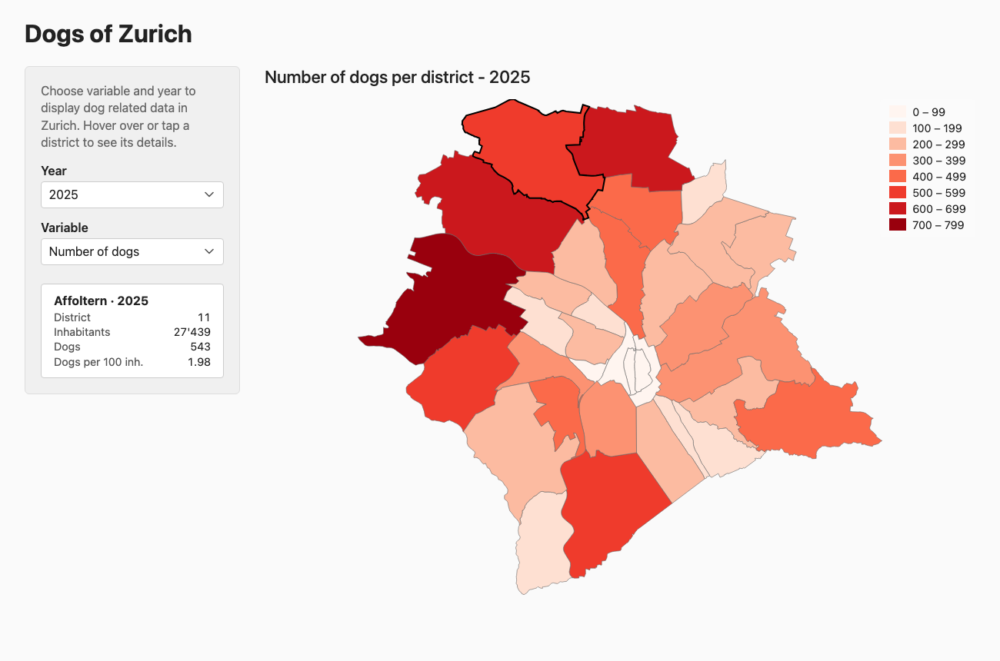

# Dogs of Zurich

Interaktive Karte zu Hunden in den Stadtzürcher Quartieren (2014–2025) – eine statische Version einer R-Shiny-App.

**Live:** https://stillsevi.github.io/dogs-of-zurich/

- `index.html` – die Webseite (reines HTML/SVG/JavaScript, keine Abhängigkeiten)
- `data.js` – aufbereitete Daten (Quartiergrenzen + Zahlen pro Jahr)
- `build-data.R` – erzeugt `data.js` aus den Rohdaten der Shiny-App

Daten: [Open Data Stadt Zürich](https://data.stadt-zuerich.ch/) (Hundebestand, Bevölkerung, statistische Quartiere).
